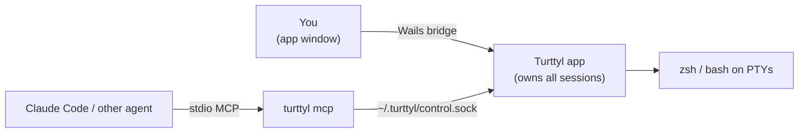

# Turttyl

A desktop terminal that **people and AI agents share**. Claude Code (or any MCP
client) works in the same sessions you see in the app window. Agent input is typed
**one character at a time**, so you can watch it happen, and if you start typing, the
agent's input stops so you can take over.

As an option that is **off by default**, a customer can turn on **elevated sessions**.
You unlock sudo once by typing your password in the terminal, and agents can then run
root commands without asking for it.

Status: **v0.1.0 Alpha**. macOS and Linux. Windows and a browser mode are planned (see
[the Change Request](documents/v0.1.0/alpha/v0.1.0%20-%20Change%20Request%20(Turttyl).md)).



## Quick start

You need Go 1.27 or newer, Node.js 20 or newer, and:

- **macOS**: Xcode Command Line Tools (`xcode-select --install`).
- **Linux**: GTK and WebKitGTK development packages (for example
  `sudo apt install build-essential libgtk-3-dev libwebkit2gtk-4.1-dev`). *Not yet
  verified on Linux.*

```bash
make build
```

```bash
./build/turttyl
```

On macOS, `make app` also creates `build/Turttyl.app` that you can drag to
Applications. It is not signed yet, so the first time you open it, right-click it and
choose **Open**.

## Connect Claude Code

The app must be open. Then add the MCP server once, using the full path of the binary:

```bash
claude mcp add turttyl -- "$(pwd)/build/turttyl" mcp
```

For the `.app` build, use
`"/Applications/Turttyl.app/Contents/MacOS/turttyl"` as the path.
Any other MCP client can run the same command over stdio.

### Tools agents get

| Tool | What it does |
|---|---|
| `list_sessions` | Sessions with id, name, folder, state, `elevated`, and who is typing |
| `create_session` | Open a new normal session (a new tab in the app) |
| `run_command` | Type a command, press Enter, wait for it to finish; returns output and exit code. Returns early (`running: true`) if the command goes quiet, for example at a y/n question |
| `wait_for_command` | Keep waiting for the running command; returns output and exit code |
| `request_human_input` | Ask you to act in a session (answer a prompt, pick from a menu, approve something) and wait until you hand back |
| `type` | Type text character by character, optionally pressing Enter |
| `send_keys` | Press keys such as `ctrl-c`, `tab`, arrows, `escape` |
| `read_output` | Read output as plain text; pass the returned `cursor` to get only new output |
| `close_session` | Close a session the agent created |

If you type while an agent is typing, the agent's call returns `interrupted_by_human`.
Agents can't create elevated sessions, and they can't close yours.

## The window

Sessions are tabs in the title bar, like a browser. On macOS the window uses Liquid
Glass; the terminal itself sits on a solid card so text stays sharp. It follows the
system's light or dark appearance, and respects Reduce Transparency, Reduce Motion and
Increase Contrast.

| Action | How |
|---|---|
| New session | **+** in the tab bar, or ⌘T |
| New elevated session | **+** → New Elevated Session… (only when enabled in config) |
| Switch session | Click a tab, or ⌘1 to ⌘9 |
| Close session | **×** on the tab, or middle-click the tab (asks first if it is still running) |
| Hand back to the agent | **Hand Back** in the notice, or ⌘↵ in the terminal |

Tab icons: a spark for a session an agent opened, a red shield for a root session, an
orange hand when an agent needs you. The right end of the tab bar shows the selected
session's folder and whether a command is running.

## When an agent needs you

Agents get stuck at prompts: a password, a `[y/N]` question, an installer menu, a
"press Enter". Here, they hand those to you and carry on.

| What happens | What you see | What the agent does |
|---|---|---|
| A command asks for a **password** (detected because the terminal turns echo off) | The tab shows **needs you**, the Dock icon bounces, and a notice asks you to type the password | It can't type into the prompt. It keeps waiting, and continues by itself once you have typed it. |
| A command goes quiet at a **question** | Nothing yet | `run_command` returns early with `running: true`, `lastLine` and `looksLikePrompt`. The agent answers it if it safely can, or asks you. |
| The agent calls **`request_human_input`** with a reason | **needs you**, the Dock bounce, and a notice with the agent's reason | It waits. You do what's asked in the terminal and click **Hand back** (or press ⌘↵). The agent then calls `wait_for_command` and continues. |

While you are being asked, other agents can't type into that session (they may still
send `ctrl-c`). The app never takes keyboard focus from another app, and it switches
tabs for you only if you haven't typed in the last 5 seconds. Otherwise a small card
in the corner says which session needs you, with a **Show** button.

> **Note on sudo in normal sessions.** If you type your password for an agent's
> `sudo` command, sudo remembers it for that terminal for a few minutes (its normal
> `timestamp_timeout`, usually 5 minutes). During that time the agent can run other
> `sudo` commands in the same session without asking.

## Elevated (sudo) sessions

They are **off** unless you turn them on. To enable them, edit
`~/.turttyl/config.json` and restart the app:

```json
{ "elevation": { "enabled": true, "idle_timeout_minutes": 30 } }
```

Then:

1. Click **New elevated session** in the app. Only a person can do this.
2. The terminal shows the sudo prompt. Type your password there (Touch ID also works
   if your Mac is set up for it). Until you do, agents can neither type into nor read
   this session.
3. The session then runs as root, with a red border and a **ROOT** badge. Agents see
   `elevated: true` and can run commands with no password.
4. It ends when you close it, when the app quits, or after the idle timeout.

How it works: the app runs `sudo -k -H -- /bin/bash` with its shell integration passed
inline. `-k` means an existing sudo ticket is never reused or left behind. Your password
goes straight from the terminal to sudo; it is never stored or logged.

> **Know what you are turning on.** Any program running as your user can connect to
> the app's socket and drive its sessions, including root sessions once they are
> unlocked. Only enable elevation on machines where that is acceptable.

## Configuration

`~/.turttyl/config.json` is created with defaults on first run. Unknown keys
are rejected, so a typo doesn't fail silently.

| Key | Default | Meaning |
|---|---|---|
| `elevation.enabled` | `false` | Allow elevated (sudo) sessions |
| `elevation.idle_timeout_minutes` | `30` | Close an elevated session after this long with no activity (1–1440) |
| `typing_delay_ms` | `20` | Default pause between characters when agents type (0–200) |
| `scrollback_kb` | `2048` | Output kept per session for agents and for redrawing the window (64–65536) |
| `default_cwd` | home folder | Where new sessions start |

Environment variables are listed in [.env.example](.env.example).

## Files the app keeps

All of these are in `~/.turttyl/` (folder mode 0700, files 0600):

| File | What it is |
|---|---|
| `config.json` | Settings |
| `control.sock` | Socket that `turttyl mcp` connects to; same-user connections only |
| `audit.jsonl` | One JSON line per event: sessions opened and closed, elevation unlocked, and every agent input. Your own keystrokes are never logged. Rotates at 10 MiB (one old file kept). |
| `shell/` | Generated zsh and bash integration files |

## Development

| Command | What it does |
|---|---|
| `make build` | Build the UI and the binary |
| `make run` | Run in development mode (web inspector enabled) |
| `make test` | Go tests with the race detector, plus the UI type-check |
| `make test-real` | Also run the shell tests against your own shell setup |
| `make lint` | `go vet` (macOS and Linux), `staticcheck`, `gofmt` |
| `make vuln` | `govulncheck` and `npm audit` |

The code follows clean architecture: `internal/domain` (types and rules) ←
`internal/app` (use cases and ports) ← `internal/adapters/*` (PTY, Wails bridge, MCP,
socket, audit, config) ← `cmd/turttyl` (wiring). The React UI is in
`frontend/`, and all of its calls to Go go through `frontend/src/transport.ts`.

More: [documents/](documents/README.md).
