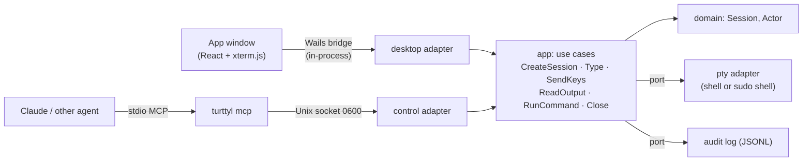

# v0.1.0 - Change Request: Turttyl

| | |
|---|---|
| **CR id** | CR-0.1.0-01 |
| **Version** | 0.1.0 (target; Alpha) |
| **Status** | In progress (approved 2026-11-27, with the Wails change in D1) |
| **Owner** | Naseeb |
| **Branch** | `feature/turttyl` |
| **Date** | 2026-11-27 |

## 1. Summary
Today, AI agents run shell commands out of sight. People only see the result if they go
and check. This CR builds a **shared terminal**: a desktop app (Go and Wails v3) runs the shells.
People use them in the app window, and Claude and other agents use the same shells
through MCP. Agent input is typed into the terminal **one character at a time**, so
people can watch it happen and step in. As an **optional feature that is off by
default**, a customer can turn on **elevated sessions**. A person unlocks sudo once
when the session starts, and agents can then run root commands with no password prompt.

## 2. Answers to the clarifying questions
| Topic | Answer |
|---|---|
| Goal | Let people see, share and take over the terminals that agents work in, live. |
| Users | Developers and operators on macOS and Linux. They work alongside Claude Code and any MCP-capable agent. |
| In scope | Desktop app (Wails v3, React and xterm.js) with session tabs; MCP server over stdio (`turttyl mcp`); character-by-character agent typing; people and agents in the same session; optional elevated (sudo) sessions; audit log. |
| Out of scope | Windows (ConPTY/UAC: a later CR); **browser mode** (`serve --web`, next CR, see D9); access from other machines; signed or notarised installers; multi-user accounts; sessions that survive a service restart; session recording and replay. |
| Edge cases | Service not running; session exited; a person and an agent typing at the same time; very large output; full-screen programs (vim, top); sudo password wrong or cancelled; elevated session left idle; browser tab closed mid-command. See §4. |
| Constraints | Go and Wails v3.1, one binary with the UI built in; no network port; agents never see or handle a password; elevation off unless the customer turns it on; licences per company rules. |
| Definition of done | The demo in §8 passes, tests pass, `govulncheck` is clean, and the docs and change note are written. |

## 3. Impact analysis
The repository is empty (greenfield), so no existing code, callers or data formats are
affected. Everything below is new.

| Area / file | How it is affected | Action |
|---|---|---|
| `cmd/turttyl/` | Composition root and CLI. | change (new) |
| `internal/domain/` | Session, Actor, input and output events. | change (new) |
| `internal/app/` | Use cases and ports. | change (new) |
| `internal/adapters/{ptyshell,desktop,mcpserver,control,audit,config}` | Adapters for the PTY, the Wails bridge, MCP, the Unix socket, the audit log and the config file. | change (new) |
| `frontend/` | React, TypeScript and xterm.js UI built by Vite and embedded with `go:embed`. | change (new) |
| `README.md`, `.env.example`, `.gitignore`, `CLAUDE.md`, `documents/` | Repo setup required by company rules. | change (new) |
| `VERSION` | Not present. It needs `0.1.0-alpha` on `develop`. See §9. | none until approved |
| `documents/AI Onboarding.md` | Nothing to audit yet. It will record a greenfield baseline once v0.1.0 code exists. | change (new) |

Suggested related improvements (not in scope unless approved):
- `read_screen` MCP tool, which renders the current screen through a VT emulator so agents can work in full-screen programs.
- An agent can *request* an elevated session, and a person approves it in the UI.
- Windows support (ConPTY, "Run as administrator" via UAC).
- Session recording and replay (asciicast format).

## 4. Design

**Sessions.** The running app owns every session; `turttyl mcp` needs the app to be open. A session is a PTY running the user's login
shell. All output goes into a ring buffer (default 2 MiB). Each line of output gets a
cursor and is sent to every viewer, whether a browser or an agent. Agents and the person at the app share one session.
Output sent to the UI is batched (about 60 updates a second) so heavy output can't flood it.

**Agent typing.** The MCP `type` tool writes characters one at a time with a
configurable delay (default 20 ms, 0–200). The app shows a banner, for example
"claude is typing…". If a person types during agent input, the person wins: the agent's
remaining characters are dropped and the tool returns `interrupted_by_human`.

**Command completion.** The service starts the shell with a small integration script
for bash and zsh. The script sources the user's own rc files, then emits OSC 133 prompt
markers, including the exit code. `run_command` types the command, waits for the
marker or its timeout, and returns the output (ANSI stripped) and the exit code.

**MCP tools** (`turttyl mcp`, stdio):

| Tool | Purpose |
|---|---|
| `list_sessions` | id, name, cwd, state, `elevated`, who is attached |
| `create_session` | new **normal** session (agents can never create elevated ones) |
| `type` | type text into a session, optionally pressing Enter |
| `send_keys` | special keys: Ctrl-C, Ctrl-D, Tab, arrows, Esc |
| `read_output` | output since a cursor, ANSI stripped, size-capped |
| `run_command` | type and wait for completion; returns output and exit code |
| `close_session` | end a session the agent created |

**Elevated sessions (optional, off by default).**
- Turned on only through the config file (`"elevation": {"enabled": true}` in
  `~/.turttyl/config.json`). When it is off, the UI hides the button and the API refuses.
- Only a **person in the app window** can start one (the control socket has no way to) ("New elevated session"). The app runs
  `sudo -k -H -- /bin/bash` with the integration script passed inline (no file root
  would read from a user-writable folder), **in that terminal**. `-k` means a cached
  sudo ticket is never reused or left behind. The person types the password into the sudo prompt; the password goes
  straight to sudo on the PTY and is never logged. Touch ID for sudo also works if the
  Mac is set up for it.
- Until the root prompt appears (the first OSC 133 marker), the session is in the
  `authenticating` state. In that state agent input is refused and agents cannot read
  the session's output. This stops an agent from ever typing into or reading the
  password prompt.
- After unlock the shell is root, so agents run commands with no password. The session
  shows a red border and a **ROOT** badge, and `list_sessions` reports `elevated: true`.
- The session ends when it is closed, when its shell exits, when the service stops, or
  after an idle timeout (default 30 min, configurable). The sudo credential is never
  cached beyond the session's own shell.
- Start, unlock, end, and every agent command in the session are written to the audit
  log.

**Security.**
- No network port: the UI talks to Go over the Wails in-process bridge.
- The control socket is `~/.turttyl/control.sock`, created with mode 0600 in a
  0700 directory. The server also checks that the connecting process belongs to the
  same user (peer credentials).
- Any process running as this user can drive the sessions through the socket. With
  elevation on, that includes root sessions; this is the feature, and the reason it is
  off by default and documented as such.
- The UI is served with a strict CSP, xterm.js is bundled (no CDN), and the UI never
  uses `innerHTML` with data.
- All inputs are validated and length-limited (for example `type` text ≤ 8 KiB, session
  names ≤ 64 printable characters, `cwd` must be an existing directory).
- The audit log `~/.turttyl/audit.jsonl` (0600) records agent input in full.
  For people it records only that they typed, never their keystrokes, because those can
  include passwords.

**Human hand-off (added 2026-11-27, at the developer's request).** Agents get stuck at
interactive prompts. Now:
- The app checks each terminal's mode four times a second. Echo off with line mode on
  means a password prompt. Agents can't type into it (only `ctrl-c` is allowed). If an
  agent is waiting on the command, the session is flagged `attention: password` and the
  Dock icon bounces. The flag clears when the prompt goes away, and the agent's wait
  continues.
- `run_command` returns early with `running: true` when output is idle (30 s by
  default, 2 s when the last line looks like a question) and gives `lastLine` and
  `looksLikePrompt`.
- New MCP tools: `wait_for_command`, and `request_human_input(reason)`, which flags the
  session (`attention: input`) and waits until the person clicks **Hand back** (⌘↵),
  the command finishes, or the timeout passes.
- While attention is set, other agents can't type into that session. The app never
  steals keyboard focus, and switches tabs by itself only if the person hasn't typed
  for 5 s.

### Decisions
| # | Decision | Reason | Alternatives considered |
|---|---|---|---|
| D1 | Desktop app with Wails v3.1 (React and xterm.js) | One Go binary that is both the app and the MCP server; no localhost port to secure (developer's choice, changed from "local web UI" at approval) | Local web UI; Electron/Tauri; TUI only; Wails v2.17 |
| D2 | Go, one binary | Easy to give to customers, no runtime needed (developer's choice) | TypeScript with node-pty |
| D3 | macOS and Linux first | Both use Unix PTYs and sudo (developer's choice) | Windows in v1 |
| D4 | A person unlocks sudo in the terminal at launch | Agents never handle a password; no permanent change to the system (developer's choice) | NOPASSWD sudoers rule |
| D5 | MCP runs as a thin stdio process that talks to `serve` over a Unix socket | Every agent client supports stdio MCP; one service owns all sessions | MCP over HTTP from the service |
| D6 | When a person and an agent type at once, the person wins | People must always be able to take over | Input lock; queueing |
| D7 | OSC 133 shell integration to detect when a command finishes | Exact exit codes, no guessing | Output idle timeout; sentinel echo |
| D9 | Browser mode comes in a later CR | The developer chose desktop first. The React UI reaches Go through one small `transport` module, so a WebSocket transport (and Wails v3's server mode) can be added later without UI changes. | Both in v0.1.0 |
| D11 | Detect password prompts from the terminal mode (echo off, ICANON on) | Reliable for sudo, ssh, `read -s` and the like, with no guessing from text; full-screen programs turn ICANON off too, so they are not mistaken for one | Matching "password:" text |
| D12 | Never take keyboard focus; only bounce the Dock and switch tabs when the person is idle | Keystrokes meant for another app or tab must never land in a terminal, especially at a password prompt | Bringing the window to the front |
| D13 | Follow Apple's HIG: session tabs in the title bar (like a browser), a native Liquid Glass window backdrop on macOS, the terminal on an opaque card, glass notices, menus and alert sheets, system colours in light and dark | Modern, native-feeling UI; tabs leave the terminal the full width; glass only on chrome, never behind terminal text, so it stays legible | A sidebar list (took too much width); glass behind the terminal (hurts legibility) |
| D14 | Name the product **turttyl**; repo `github.com/naseebnaushad/turttyl` | Developer's decision | — |
| D10 | Elevated shells always use `/bin/bash` | Its `--rcfile` lets the integration be passed inline as root; root's own rc files are still read | The user's login shell |
| D8 | Config file is JSON (`~/.turttyl/config.json`) | Go standard library, no extra dependency | TOML, YAML |

## 5. Feature parity (rewrites/migrations only)
Not applicable: there is no existing code.

## 6. Security checklist
- [x] Input validated and length-limited at boundaries
- [x] Output encoded for context; no innerHTML/eval with data
- [x] AuthN/AuthZ enforced server-side; least privilege
- [x] Secrets never logged/committed; read from environment / secrets manager
- [x] Errors generic to users; details in logs without personal data
- [x] TLS + timeouts on network calls: local only, so no TLS (127.0.0.1 and Unix socket); timeouts on all HTTP handlers
- [x] New dependencies: licence allowed, maintained, no known vulnerabilities
- [x] Vulnerability scan clean

## 7. Dependencies
Versions are pinned to the latest stable release at build time (in `go.mod` or the
vendored files) and recorded in the change note.

| Package | Licence | Why needed |
|---|---|---|
| `github.com/creack/pty` v1.1.24 | MIT | Start and resize PTYs on macOS and Linux |
| `github.com/modelcontextprotocol/go-sdk` v1.8.0 | MIT / Apache-2.0 (relicensing in progress; both allowed) | Official MCP server SDK |
| `github.com/wailsapp/wails/v3` v3.1.0 | MIT | Desktop window and Go–JS bridge |
| `golang.org/x/sys` | BSD-3-Clause | Peer-credential check on the control socket |
| `@wailsio/runtime`, `@xterm/xterm`, `@xterm/addon-fit`, `react`, `react-dom` (npm, bundled by Vite) | MIT | UI |
| `vite`, `typescript`, `@vitejs/plugin-react` (build only) | MIT / Apache-2.0 | Frontend build |

## 8. Test approach
- **Unit:** domain and use cases with fake ports, covering typing, interruption,
  cursors, the ring buffer, validation, and the elevation rules (off by default; agents
  cannot create elevated sessions; agents are blocked while `authenticating`).
- **Integration:** a real PTY with bash and zsh. `run_command` returns the output and
  exit code; the MCP tools are tested end to end over stdio against a running `serve`;
  the control socket rejects bad input.
- **Live demo (definition of done):**
  1. Open the app.
  2. `claude mcp add turttyl -- turttyl mcp`, then ask Claude to run
     `ls` and `git status`. The app shows them typed character by character.
  3. A person types in the same session, and Claude reads that output.
  4. With elevation off: the button is hidden and the API refuses.
  5. With elevation on: a person unlocks; Claude runs `whoami` → `root` with no prompt;
     closing the session ends the root shell; the audit log shows all of it.
- Elevated tests need a real sudo password. A person runs them by hand, and the results
  are recorded in the Alpha test cases.

## 9. Open questions
- **VERSION bootstrap:** the first push is the `feature/turttyl` branch only. `main` and
  `develop` (with `VERSION` = `0.1.0-alpha`) are protected branches; a person creates
  them. Until then, builds are labelled `0.1.0-alpha.dev`.
- **GitHub repository:** decided. `github.com/naseebnaushad/turttyl` (the developer's
  personal account); the Go module has the same path.
- **Product name:** decided: **turttyl** (shown as "Turttyl" in the window and the app
  bundle).

## 10. Change history
| Date | Version | Change |
|---|---|---|
| 2026-11-27 | 0.1.0-alpha | CR created |
| 2026-11-27 | 0.1.0-alpha | Approved; switched to a Wails v3.1 desktop app; browser mode moved to a later CR |
| 2026-11-27 | 0.1.0-alpha.dev | First build done; see the change note. Real-sudo and Linux tests still to run. |
| 2026-11-27 | 0.1.0-alpha.dev | Scope added: human hand-off (password prompts, quiet prompts, `request_human_input`, `wait_for_command`) |
| 2026-11-27 | 0.1.0-alpha.dev | UI redesigned to Apple's HIG with tabs in the title bar and Liquid Glass (D13); renamed to turttyl (D14) |
